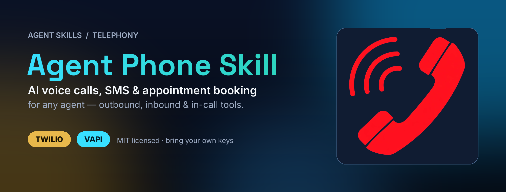
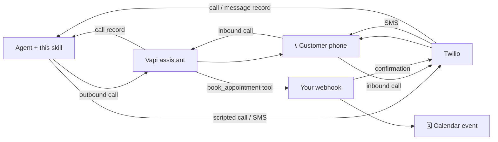

<p align="center">
  
</p>

<p align="center">
  <a href="LICENSE"></a>
  
  
  
  
  
</p>

<h1 align="center">📞 Agent Phone Skill</h1>

<p align="center">
  <strong>Give your AI agent a phone.</strong><br>
  Outbound AI voice calls · inbound AI receptionist · SMS · in-call appointment booking<br>
  A portable <a href="https://agentskills.io">Agent Skills</a> package that works with any agent framework.
</p>

---

## What it does

Most agents can only type. This skill teaches an agent to **use the
telephone network** — safely, with approval gates and honest reporting:

| | Capability |
|---|---|
| 📤 | **Outbound conversational calls** — an AI voice agent that pitches, answers objections, and follows a script (Vapi) |
| 📥 | **Inbound receptionist** — a number that answers itself, greets callers, and helps them (Vapi assistant or Twilio TwiML) |
| 📅 | **In-call booking** — the assistant collects details, writes a real calendar event via webhook, and confirms by SMS |
| 💬 | **SMS** — confirmations, reminders, and follow-ups with delivery tracking (Twilio) |
| 📼 | **Receipts, not vibes** — every call reported from the provider record: status, ended reason, cost, transcript, recording |
| 🛑 | **Gates built in** — human approval before dialing, instant opt-out handling, never-contact scrubbing, spend tracking |

## How it works



**Vapi is the brain** (conversation, tools, transcripts). **Twilio is
the pipes** (numbers, plain calls, SMS) — and a Twilio number can be
imported into Vapi when you outgrow the free-number limits.

## Capability matrix

| Capability | Vapi | Twilio |
|---|:---:|:---:|
| Outbound conversational AI call | ✅ | ⚙️ DIY (Media Streams + your STT/LLM/TTS) |
| Outbound scripted call | ✅ | ✅ |
| Inbound AI receptionist | ✅ | ✅ (TwiML routing / DIY brain) |
| SMS send & receive | — | ✅ |
| In-call booking tool | ✅ | ✅ (Gather + webhook) |
| Transcript + AI summary | ✅ built-in | ⚙️ add-ons |
| Recording URL per call | ✅ | ✅ |

## Quickstart

1. **Install the skill** — copy this folder into your agent's skills
   directory (e.g. `.claude/skills/agent-phone-skill/`, or your
   framework's equivalent). The agent reads `SKILL.md`.
2. **Get keys** — a [Vapi](https://vapi.ai) private API key and/or
   Twilio Account SID + Auth Token. Put them in environment variables
   or your secret manager — **never in code, never in the repo**:

   ```bash
   export VAPI_API_KEY="..."
   export TWILIO_ACCOUNT_SID="AC..."
   export TWILIO_AUTH_TOKEN="..."
   ```

3. **Run the booking example** (stdlib-only Python, no installs):

   ```bash
   cd examples/booking-webhook
   python3 server.py        # http://127.0.0.1:8080
   curl -s http://127.0.0.1:8080/health
   ```

4. **Test call first** — always dial your own number before any real
   contact, and confirm the opener, audio, and booking tool end-to-end.
5. **Approve, then dial** — the skill's gates require an approved list,
   script, and spend envelope for every campaign.

## File map

```
agent-phone-skill/
├── SKILL.md                              ← the skill itself (start here)
├── skill.yaml                            ← skill metadata
├── README.md
├── LICENSE                               ← MIT
├── assets/
│   ├── banner.png
│   └── icon.png
├── references/
│   ├── vapi.md                           ← endpoints, call records, refusals, costs
│   └── twilio.md                         ← TwiML, SMS, trial rules, inbound routing
└── examples/
    ├── booking-webhook/
    │   ├── server.py                     ← working booking webhook (stdlib only)
    │   └── README.md                     ← data contract + wiring guide
    ├── booking-receptionist-prompt.md    ← sample inbound receptionist prompt
    └── outbound-campaign-script.md       ← outbound script template with objection ladder
```

## Safety model

This is a *contacts-people, costs-money* capability, so the skill ships
with non-negotiable gates:

- ✅ **Human approval** for the exact list, script, and budget — per campaign
- ✅ **Opt-out is instant and permanent** — "remove me" ends the call and flags never-contact
- ✅ **Never-contact lists scrubbed in code** before every batch
- ✅ **Keys only from secret storage** — environment/vault, never chat or code
- ✅ **Spend tracked per call** against the approved envelope
- ✅ **Honest identity** — the agent names the business and never claims to be human

## Known platform limits *(observed 2026-11 — verify before relying on them)*

- **Vapi free numbers:** ~10 outbound calls/day cap; US free numbers
  can't call international numbers. Importing your own Twilio number
  removes both. Platform fee ≈ $0.05/min plus pass-through.
- **Vapi API** sits behind Cloudflare — some HTTP clients need a normal
  browser `User-Agent` header or they get `403 / error 1010`.
- **Twilio trial:** verified numbers only, a trial preamble on calls,
  and a prefix on trial SMS. Real outreach needs a paid account.

Full detail in [`SKILL.md`](SKILL.md) and the `references/` files.

## License

[MIT](LICENSE) — use it, fork it, ship it. Bring your own Twilio/Vapi
accounts and keys; this project is not affiliated with Twilio or Vapi.
